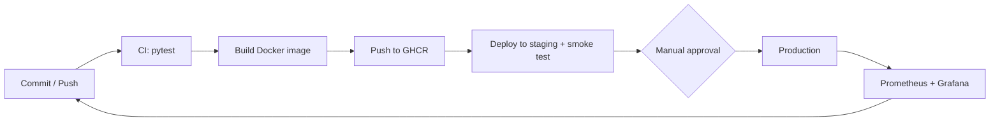

# Release Loop

Small FastAPI service that goes through a complete DevOps cycle:
commit, CI, container image, staging, manual approval, production and monitoring.

## Flow



## Stack

- Python, FastAPI, pytest
- Docker, GitHub Actions, GitHub Container Registry
- Prometheus and Grafana (via Docker Compose)

## Run locally

```bash
docker compose up --build
```

- API: http://127.0.0.1:8001/health
- Prometheus: http://127.0.0.1:9090
- Grafana: http://127.0.0.1:3000

## Monitoring


## What I'd add next

- Real deployment target (Azure Container Apps or Kubernetes)
- Infrastructure as Code with Terraform
- Vulnerability scanning of the image in the pipeline
